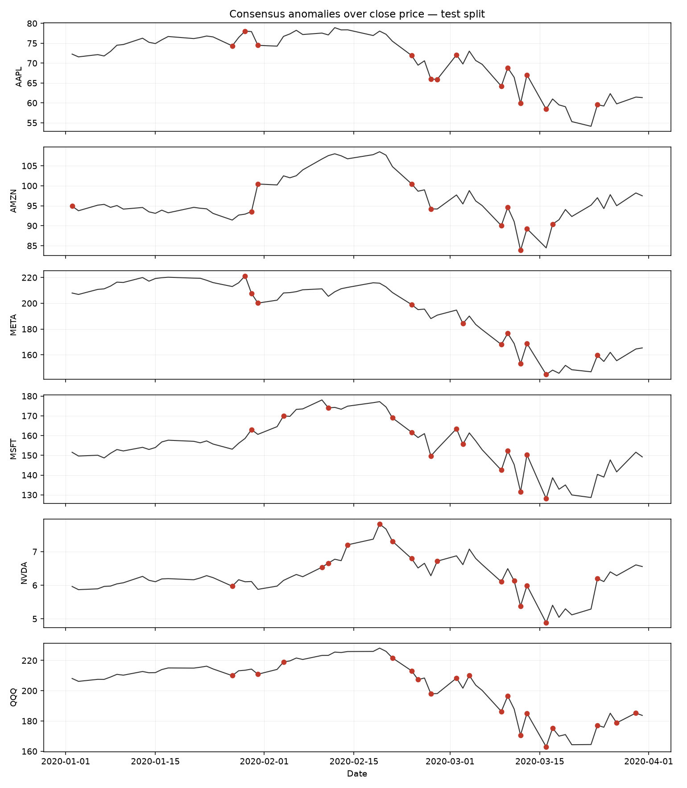

# Stock Market Anomaly Detection

Unsupervised detection of abnormal trading sessions across six US equities
(QQQ, AAPL, MSFT, NVDA, AMZN, META), trained on 2018, calibrated on 2019, and
evaluated on the first quarter of 2020.

Three detectors run in parallel — a threshold rule layer, a K-Means distance
layer, and a walk-forward DBSCAN layer — and their union forms the consensus
flag. A cross-sectional market layer sits on top and marks whole sessions as
stressed.

The point of the project is not the detectors, which are standard. It is the
discipline around them: in a time series, the easiest way to get a good-looking
anomaly detector is to accidentally let it see the future, and most of the code
here exists to make that impossible and then to prove it.

---

## Leakage discipline

Every feature at date *t* is a function of data at or before *t*, and the
distribution each observation is scored against uses only dates strictly
*before* *t*:

```
ret_z[t]     = (ret[t] − mean(ret[t−63 : t−1])) / std(ret[t−63 : t−1])
volz[t]      = (log_vol[t] − mean(log_vol[t−21 : t−1])) / std(…)
range_pct[t] = fraction of raw_range[t−63 : t−1] strictly below raw_range[t]
```

The `.shift(1)` before each rolling window is what excludes the current day from
its own reference distribution. Without it, a large move inflates the standard
deviation it is being divided by, the z-score is biased toward zero, and the
feature quietly launders away the exact events the pipeline is meant to find.

Every fitted quantity is estimated on the training split and then applied
forward unchanged:

| Quantity | Fitted on |
|---|---|
| `StandardScaler` mean and variance | 2018 |
| K-Means centroids | 2018 |
| K-Means distance cut (97.5th percentile) | 2018 |
| Market `\|return\|` extreme cut (95th percentile) | 2018 |
| DBSCAN `eps` | 2019, to an alarm budget, without labels |

None of this is asserted by comment. `tests/test_features.py` checks it:
`test_features_are_causal` rebuilds the features on a truncated copy of the
panel and requires every overlapping value to be bit-comparable, which can only
hold if no window ever reached forward. `test_market_threshold_ignores_test_dates`
deletes the test split and requires the market cut to be unchanged.

---

## What changed from the original notebook

This started as a single-cell capstone notebook. Three defects were found and
fixed; the third is the interesting one.

**1. The market threshold leaked.** The original computed

```python
market_stats['market_ret'].abs().quantile(0.95)
```

over the entire 2017–2020 series. That quantile is a function of March 2020, so
the test period was helping to define what counted as extreme *in the test
period*. It is now estimated on 2018 only, like every other threshold.

**2. Scaling silently redefined the rule thresholds.** The original overwrote
the feature columns in place —

```python
df_processed[features] = scaler.transform(df_processed[features])
```

— and then applied `abs(row['ret_z']) > 2.5`. After that assignment `ret_z` is
no longer a trailing z-score; it is the 2018-restandardised version of one, so
"2.5" no longer means 2.5 trailing standard deviations. The two are close, since
a z-score already has roughly unit dispersion, but the reported values in the
output CSV were not the quantity the column name claimed. Scaled copies are now
written to separate `_s` columns, and the rule layer and every report read the
unscaled originals.

**3. The DBSCAN layer was inert.** The original fixed `eps = 2.0` with a comment
that Z-scores can be large. On standardised features that radius is far too
loose: essentially no point is ever labelled noise, the DBSCAN column is all
zeros, and the three-way consensus silently reduces to `rule OR k-means`. On the
synthetic fixture, `eps=2.0` with monthly blocks flags 0–4 of 396 test rows
across seeds, against 49 for the calibrated setting.

`eps` is now swept over a grid and chosen on the 2019 validation split to hit a
fixed alarm budget of 2.5% — the same budget the 97.5th-percentile K-Means cut
implies, which is what makes the two layers comparable. No labels are used for
this; the validation split only fixes how often the detector is allowed to fire.
`test_original_eps_makes_the_layer_inert` pins the defect so it cannot return.

---

## The DBSCAN block-size question

DBSCAN has no `predict`. Scoring new data means refitting on history plus the
new rows, so the result depends on how large a block you hand it. Points inside
a block count toward each other's neighbour counts, which means a larger block
can only ever supply extra density and absorb borderline points into clusters —
a sustained regime shift can, in principle, become its own cluster and stop
looking anomalous precisely because it persisted.

The pipeline runs both daily and monthly blocks and reports the gap rather than
picking one silently.

The honest result: on this data the effect is **real but small**. Monthly blocks
flag slightly fewer rows than daily (47 vs 49 on the synthetic fixture, and the
ordering is consistent across every `eps` in the grid), but nothing like the
collapse the mechanism suggests is possible. The reason is that the history is
large — roughly 3,000 rows of 2018–2019 against a ~130-row month — so the extra
intra-block density barely moves the neighbourhood counts. The mechanism needs a
short history or a long block to bite, and this configuration has neither.

Daily blocks are used for the headline results anyway, since they are the
honest simulation of live operation.

---

## Evaluation

There are no ground-truth anomaly labels, so this is a weak evaluation and worth
stating precisely.

`src/evaluate.py` contains a fixed list of twelve US equity sessions in the test
window on which the S&P 500 moved more than roughly 4.5% either way, including
the four days that tripped the NYSE level-1 circuit breaker. The list comes from
index history, not from this pipeline's features, and nothing is tuned against
it.

Recall on that list shows the detector fires on days that were unambiguously
abnormal. It shows nothing about precision — a detector that flags every day
scores perfectly — so recall is only meaningful read next to the flag rate, and
both are always reported together.

Six-ticker panel, 2018 train / 2019 val / Q1 2020 test, daily blocks:

| detector | flag rate | stress days caught | recall |
|---|---|---|---|
| rule | 0.204 | 9/12 | 0.750 |
| k-means | 0.065 | 6/12 | 0.500 |
| dbscan | 0.046 | 5/12 | 0.417 |
| consensus | 0.212 | 10/12 | 0.833 |



The table reproduces from the committed `data/prices.parquet` with `python run_pipeline.py` (no network needed).

Here the consensus earns its place: it catches one stress day that no single
layer catches alone. On 2020-03-11, NVDA's rule label is `normal` and it clears
the k-means distance cut, but it is flagged as DBSCAN noise, and that is the
session that takes recall from 9/12 to 10/12. That is a genuine instance of the
clustering layer surfacing something the threshold rule missed — a name that
moved unusually for *itself*, in a way that didn't clear a fixed z-score cut but
did put it outside its recent neighbourhood in feature space.

The rule layer still does most of the work by flag count, and DBSCAN in
particular has the lowest recall of the three on its own. The honest reading is
not "the clustering layers are essential" — it is "the clustering layers are
each individually weak but occasionally catch something orthogonal to the rule,
and the one time that happened in this window, it mattered."

---

## Layout

```
src/config.py      every window, threshold, and split boundary
src/ingest.py      Yahoo download, cached to data/prices.parquet
src/features.py    rolling features (the causality lives here)
src/detectors.py   rule / k-means / walk-forward dbscan + eps calibration
src/market.py      cross-sectional breadth and market flag
src/evaluate.py    stress-date list and recall-vs-flag-rate table
src/report.py      anomaly card, monthly report, single-date query
src/plots.py       figures
src/synthetic.py   offline fixture for tests and smoke runs
run_pipeline.py    entrypoint
tests/             leakage and threshold assertions
```

## Running it

```bash
pip install -r requirements.txt

python run_pipeline.py              # downloads once, then reads the cache
python run_pipeline.py --synthetic  # offline, no network
python run_pipeline.py --refresh    # force a re-download
pytest -q
```

Yahoo data is not stable over time — tickers get re-adjusted and the endpoint
changes — so the first successful download is written to `data/prices.parquet`
and committed. Later runs reproduce the numbers above rather than whatever the
API happens to serve that day.

Outputs land in `outputs/` (anomaly card and monthly reports as CSV) and
`figures/` (flagged sessions over price, detector agreement, market layer).

---

## Limitations

- **Six correlated large-cap tech names** is a narrow universe, and QQQ overlaps
  heavily with the other five. Cross-sectional breadth over this set is closer
  to one factor than to market breadth.
- **One regime in the test set.** Q1 2020 is a single event. Recall of 9/12 on
  twelve correlated days from one crash is not evidence the detector generalises
  to a different kind of stress.
- **The stress-date list is hand-specified.** It is defensible and was fixed
  before any output was inspected, but it is still a proxy for large index moves
  rather than for "anomaly", and it cannot measure precision at all.
- **K-Means with k=3 is unjustified.** The value is inherited from the original
  notebook; no elbow or silhouette analysis supports it.
- **The rule layer is not independent of the features.** It thresholds the same
  z-scores the clustering layers consume, so the "consensus" is less of an
  ensemble than the word suggests.

## License

MIT.
